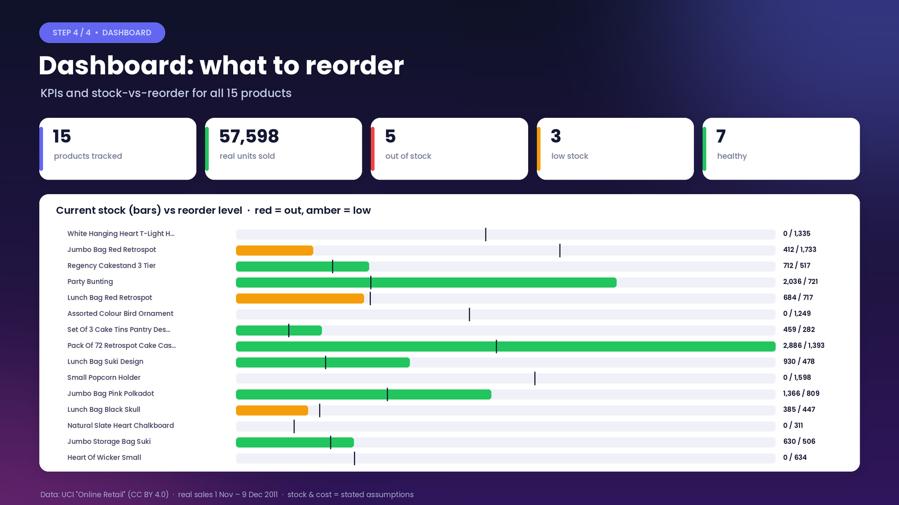
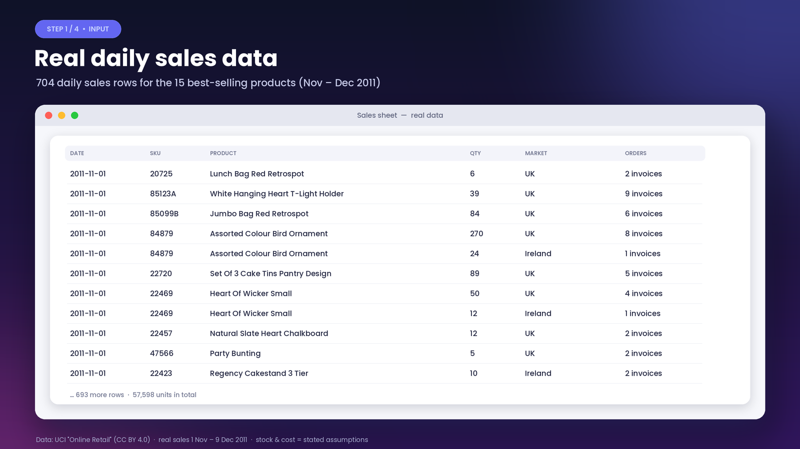
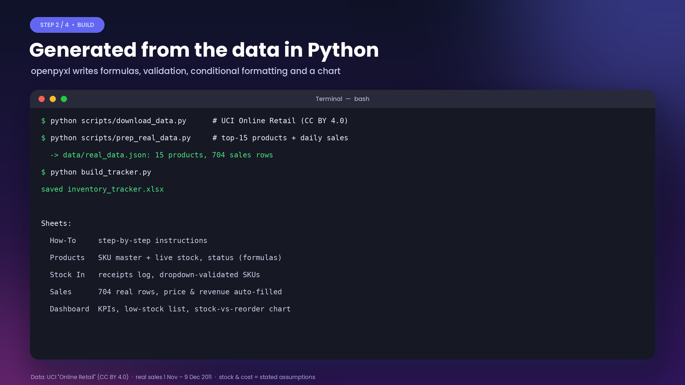
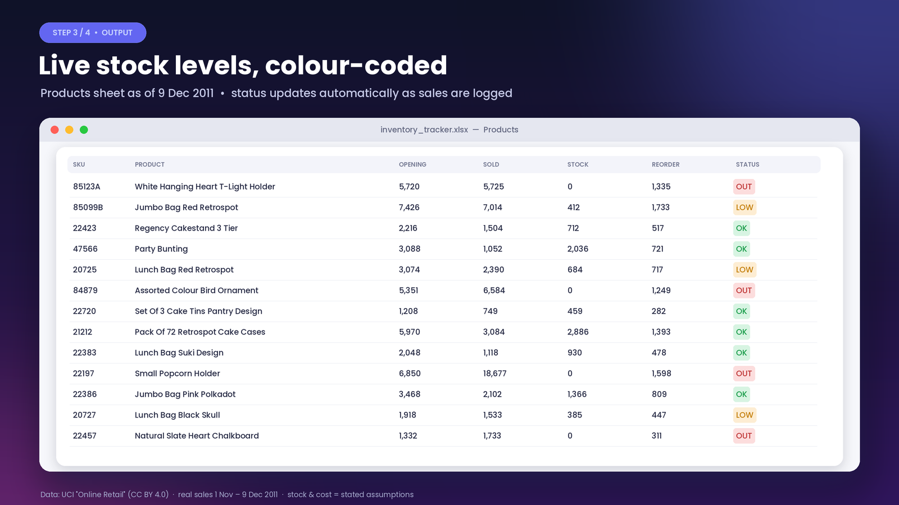

# Excel Inventory Tracker with Low-Stock Alerts

A formula-driven Excel workbook that tracks stock in and out, flags low and out-of-stock items, and shows a reorder dashboard. It's generated in Python and demoed on real sales data.



[▶ Watch the 38-second demo video](docs/demo.mp4)

## Problem
Small sellers often track stock in an ad-hoc sheet. They find out an item is out of stock only when an order fails, and there's no single view of what to reorder.

## Solution
`build_tracker.py` (Python + openpyxl) generates `inventory_tracker.xlsx` with 5 sheets:
- **How-To**: step-by-step instructions for the client
- **Products**: SKU master; received, sold, current stock and status are calculated by formulas
- **Stock In**: receipts log with a dropdown-validated SKU column
- **Sales**: sales log; unit price, revenue and product name fill in automatically
- **Dashboard**: KPIs, low-stock list and a stock-vs-reorder bar chart, with conditional formatting (OK / LOW / OUT)

It needs no macros and works in Excel and LibreOffice.

## Results (real data demo)
The 15 best-selling products (by number of invoices) from the **UCI Online Retail** dataset, with their **real daily sales from 1 Nov to 9 Dec 2011: 704 sales rows, 57,598 units**.

Status on 9 Dec 2011: **5 out of stock, 3 low, 7 healthy**.

> **Assumptions.** The dataset has sales but no stock or cost figures, so these are modelled. Opening stock on 1 Nov 2011 = 60 days of average daily demand (Dec 2010 to Oct 2011). Reorder level = 14 days of demand. Unit cost = 60% of the average selling price. Stock can't go below 0. The stock levels shown are therefore a simulation driven by real sales, not a real warehouse count.

## Quick start
Just open `inventory_tracker.xlsx` to use the demo. To rebuild it:
```bash
pip install -r requirements.txt
python build_tracker.py                               # uses data/real_data.json (committed, 37 KB)
# optional, regenerate data/real_data.json from the raw dataset:
python scripts/download_data.py && python scripts/prep_real_data.py
```
To use it for your own shop, clear the demo rows and enter your own products, stock-in and sales.

## Screenshots
| | |
|---|---|
|  |  |
|  |  |

## Data source & licence
- Demo data: Chen, D. (2015). *Online Retail* [Dataset]. UCI Machine Learning Repository. https://doi.org/10.24432/C5BW33, licensed **CC BY 4.0**. `data/real_data.json` is a derived extract (top-15 products, daily totals). The raw file is not committed.
- Code: MIT licence, see [LICENSE](LICENSE).
